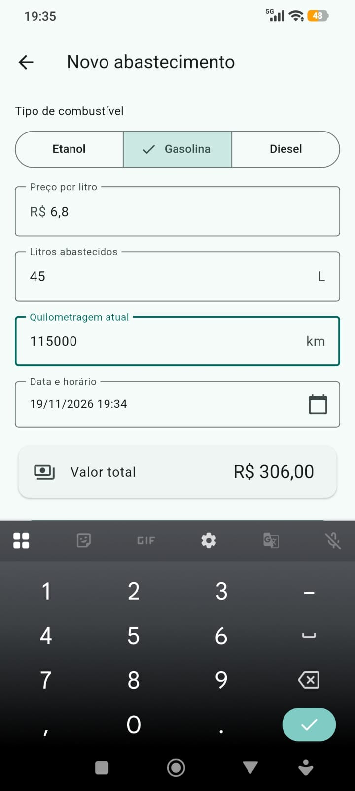
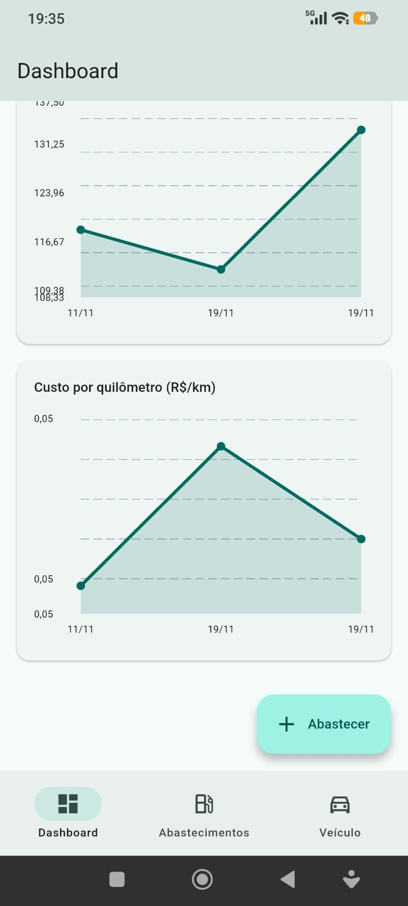
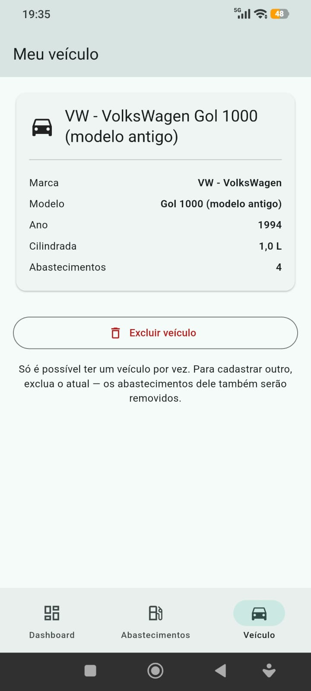

# Controle de Combustível

Aplicativo Flutter para registrar abastecimentos de um veículo e acompanhar gastos e consumo ao longo do tempo.
Projeto da **Atividade Substitutiva da Prova 1** — Programação para Dispositivos Móveis II (FATEC).

## Funcionalidades

- **Cadastro de um único veículo** (marca, modelo, ano e cilindrada). Marca e modelo vêm da API pública (BrasilAPI / tabela FIPE); os modelos listados dependem da marca escolhida.
- **Exclusão do veículo** com confirmação — remove também todos os abastecimentos associados.
- **Registro de abastecimentos**: combustível (etanol, gasolina ou diesel), preço por litro, quilometragem, litros e data/hora. O valor total (preço × litros) é calculado automaticamente.
- **Persistência local**: os dados permanecem após fechar e abrir o app.
- **Dashboard** com gráficos de valor de cada abastecimento, consumo (km/L) e custo por km (R$/km).

### Cálculo dos indicadores (todos os registros são "tanque cheio")

A partir do 2º abastecimento:

- Distância = km atual − km do abastecimento anterior
- km/L = distância ÷ litros do abastecimento atual
- R$/km = valor total do abastecimento atual ÷ distância

O 1º abastecimento é a referência inicial e não tem km/L nem R$/km.

## Como executar

Pré-requisitos: [Flutter SDK](https://docs.flutter.dev/get-started/install) e Git.

```bash
git clone https://github.com/Anderson-Fontes/controle-combustivel.git
cd controle-combustivel
flutter pub get
flutter run -d chrome      # ou -d <id do dispositivo Android>
```

Testes: `flutter test`

## API e bibliotecas

- **API:** [BrasilAPI — FIPE](https://brasilapi.com.br/docs#tag/FIPE) (`/fipe/marcas/v1/carros` e `/fipe/veiculos/v1/carros/{codigoMarca}`)
- `provider` — gerenciamento de estado
- `http` — consumo da API
- `shared_preferences` — persistência local
- `fl_chart` — gráficos
- `intl` e `flutter_localizations` — formatação e localização pt-BR

## Estrutura

```
lib/
├── main.dart
├── models/      vehicle.dart, refuel.dart
├── services/    brasil_api_service.dart, storage_service.dart
├── state/       app_state.dart
├── utils/       calculations.dart, formatters.dart
├── widgets/     charts.dart, picker_field.dart, confirm_dialog.dart
└── screens/     home, dashboard, abastecimentos, veículo, formulários

## Como testar

### Testes automatizados

```bash
flutter test
```

Os testes (`test/calculations_test.dart`) verificam o valor total (preço × litros) e os indicadores: o primeiro abastecimento não tem km/L nem R$/km, e os seguintes seguem as fórmulas da atividade.

### Roteiro de teste manual

Requer internet (a lista de marcas e modelos vem da BrasilAPI).

1. **Cadastro do veículo**
   - Ao abrir o app pela primeira vez, a tela de cadastro é exibida.
   - Escolha a **marca**. O campo **modelo** só é habilitado depois e lista apenas os modelos daquela marca.
   - Trocando a marca, o modelo selecionado é limpo e a lista é recarregada.
   - Tente salvar com campos vazios ou ano inválido: o app mostra a validação.
   - Preencha ano e cilindrada e salve. O app abre o Dashboard.

2. **Registro de abastecimentos**
   - Toque em **Abastecer**, escolha o combustível (etanol, gasolina ou diesel) e informe preço por litro, litros, quilometragem e data/hora.
   - O **valor total** (preço × litros) é exibido em tempo real.
   - Registre pelo menos 3 abastecimentos em ordem cronológica.
   - Tente informar uma quilometragem menor ou igual à do abastecimento anterior: o app recusa.

3. **Indicadores**
   - Na aba **Abastecimentos**, o primeiro registro aparece como referência, sem km/L nem R$/km.
   - A partir do segundo, confira os cálculos:
     - distância = km atual − km anterior
     - km/L = distância ÷ litros do abastecimento atual
     - R$/km = valor total do abastecimento atual ÷ distância
   - Exemplo de conferência: 1º abastecimento em 10000 km; 2º com 38 L a R$ 5,90 em 10450 km → 450 km, 11,84 km/L e R$ 0,498/km.

4. **Dashboard**
   - Confira os cards de resumo (total gasto, média km/L e média R$/km).
   - Confira os gráficos: valor de cada abastecimento, consumo (km/L) e custo por km (R$/km).
   - Com apenas 1 abastecimento, os gráficos de km/L e R$/km mostram uma mensagem pedindo mais registros.

5. **Persistência local**
   - Feche o app completamente e abra de novo: veículo e abastecimentos continuam salvos.

6. **Exclusão de abastecimento**
   - Na aba **Abastecimentos**, toque na lixeira e confirme. O registro some e os indicadores são recalculados.

7. **Exclusão do veículo**
   - Na aba **Veículo**, toque em **Excluir veículo**. O app pede confirmação e informa que os abastecimentos também serão removidos.
   - Após confirmar, o app volta ao cadastro e nenhum abastecimento do veículo anterior permanece.

### Instalar o APK no Android

O APK é gerado automaticamente pelo GitHub Actions a cada push na branch `main`:

1. Abra a aba **Actions** do repositório e entre na execução mais recente de **Build APK**.
2. Baixe o artefato `controle-combustivel-apk` e extraia o `.zip`.
3. Envie o `app-release.apk` para o celular e instale (pode ser necessário permitir a instalação de fontes desconhecidas).
```

## Capturas de tela

| Cadastro do veículo | Novo abastecimento | Abastecimentos |
|---|---|---|
|  |  |  |

| Dashboard (resumo e valor por abastecimento) | Dashboard (consumo e custo por km) | Meu veículo |
|---|---|---|
|  |  |  |
