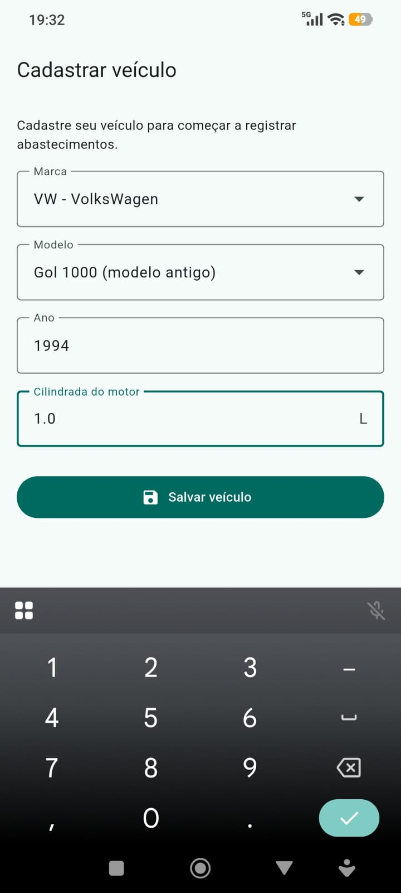
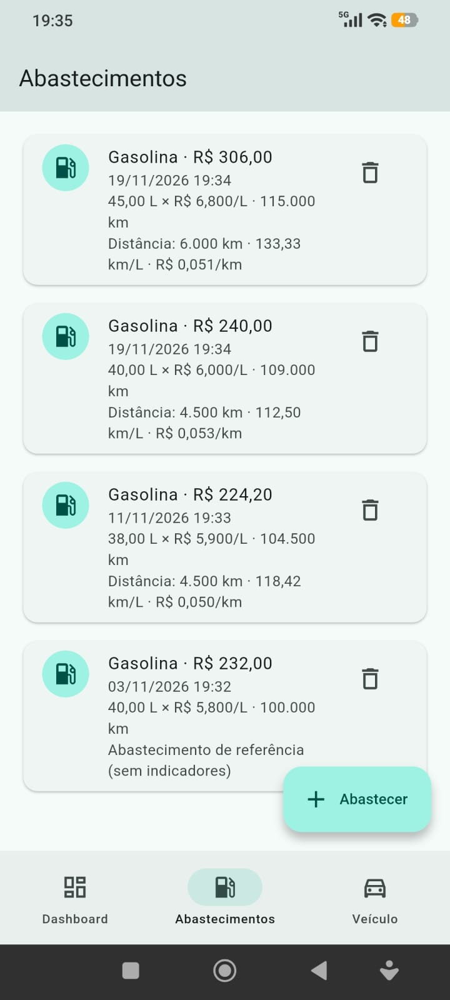
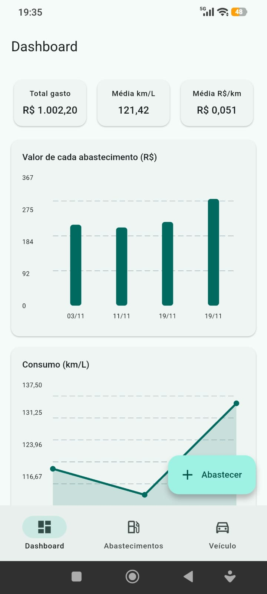

# Controle de Combustível

Aplicativo Flutter para registrar abastecimentos de um veículo e acompanhar gastos e consumo ao longo do tempo.
Projeto da **Atividade Substitutiva da Prova 1** — Programação para Dispositivos Móveis II (FATEC).

## Funcionalidades

- **Cadastro de um único veículo** (marca, modelo, ano e cilindrada). Marca e modelo vêm da API pública (BrasilAPI / tabela FIPE); os modelos listados dependem da marca escolhida.
- **Exclusão do veículo** com confirmação — remove também todos os abastecimentos associados.
- **Registro de abastecimentos**: combustível (etanol, gasolina ou diesel), preço por litro, quilometragem, litros e data/hora. O valor total (preço × litros) é calculado automaticamente.
- **Persistência local**: os dados permanecem após fechar e abrir o app.
- **Dashboard** com gráficos de valor de cada abastecimento, consumo (km/L) e custo por km (R$/km).

### Cálculo dos indicadores (todos os registros são "tanque cheio")

A partir do 2º abastecimento:

- Distância = km atual − km do abastecimento anterior
- km/L = distância ÷ litros do abastecimento atual
- R$/km = valor total do abastecimento atual ÷ distância

O 1º abastecimento é a referência inicial e não tem km/L nem R$/km.

## Como executar

Pré-requisitos: [Flutter SDK](https://docs.flutter.dev/get-started/install) e Git.

```bash
git clone https://github.com/Anderson-Fontes/controle-combustivel.git
cd controle-combustivel
flutter pub get
flutter run -d chrome      # ou -d <id do dispositivo Android>
```

Testes: `flutter test`

## API e bibliotecas

- **API:** [BrasilAPI — FIPE](https://brasilapi.com.br/docs#tag/FIPE) (`/fipe/marcas/v1/carros` e `/fipe/veiculos/v1/carros/{codigoMarca}`)
- `provider` — gerenciamento de estado
- `http` — consumo da API
- `shared_preferences` — persistência local
- `fl_chart` — gráficos
- `intl` e `flutter_localizations` — formatação e localização pt-BR

## Estrutura

```
lib/
├── main.dart
├── models/      vehicle.dart, refuel.dart
├── services/    brasil_api_service.dart, storage_service.dart
├── state/       app_state.dart
├── utils/       calculations.dart, formatters.dart
├── widgets/     charts.dart, picker_field.dart, confirm_dialog.dart
└── screens/     home, dashboard, abastecimentos, veículo, formulários
```

## Capturas de tela

| Cadastro do veículo | Novo abastecimento | Abastecimentos |
|---|---|---|
|  |  |  |

| Dashboard (resumo e valor por abastecimento) | Dashboard (consumo e custo por km) | Meu veículo |
|---|---|---|
|  |  |  |
